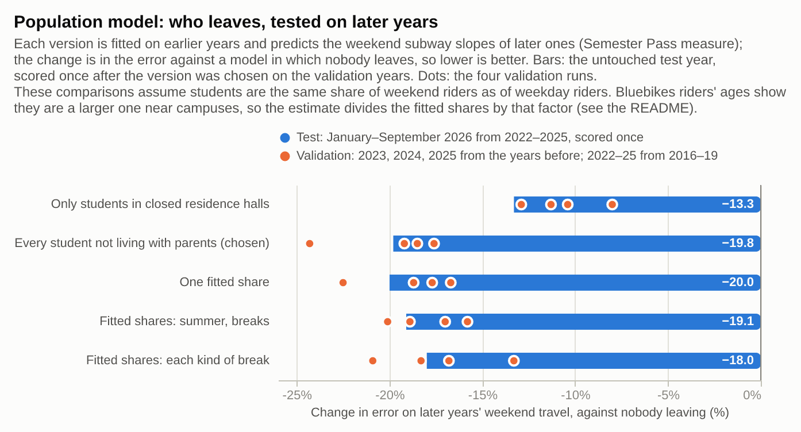
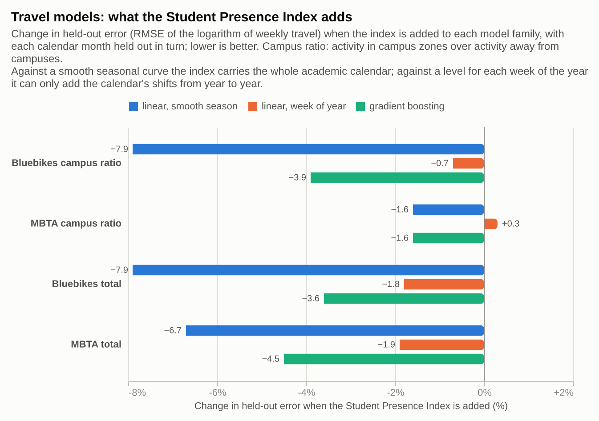
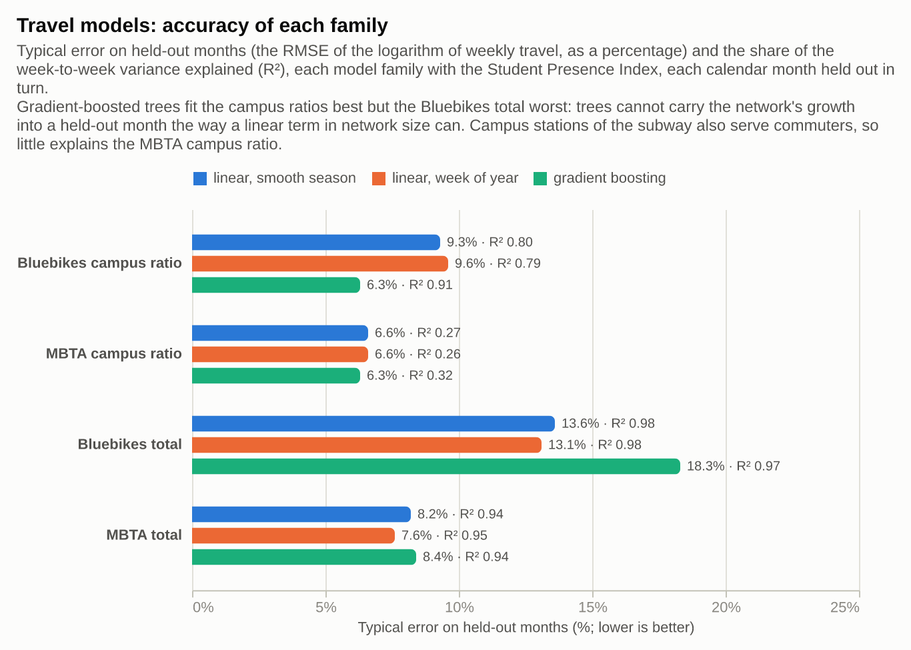
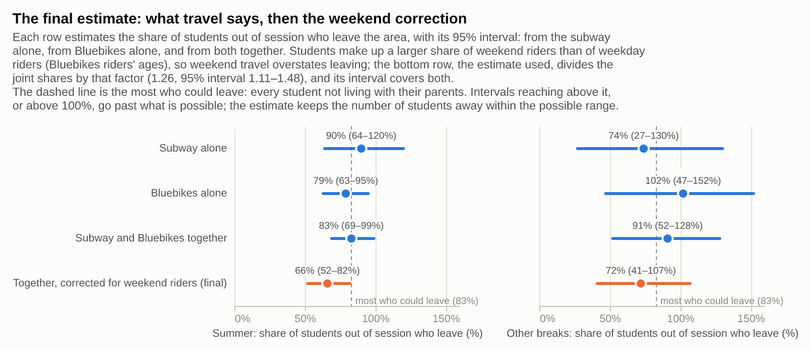
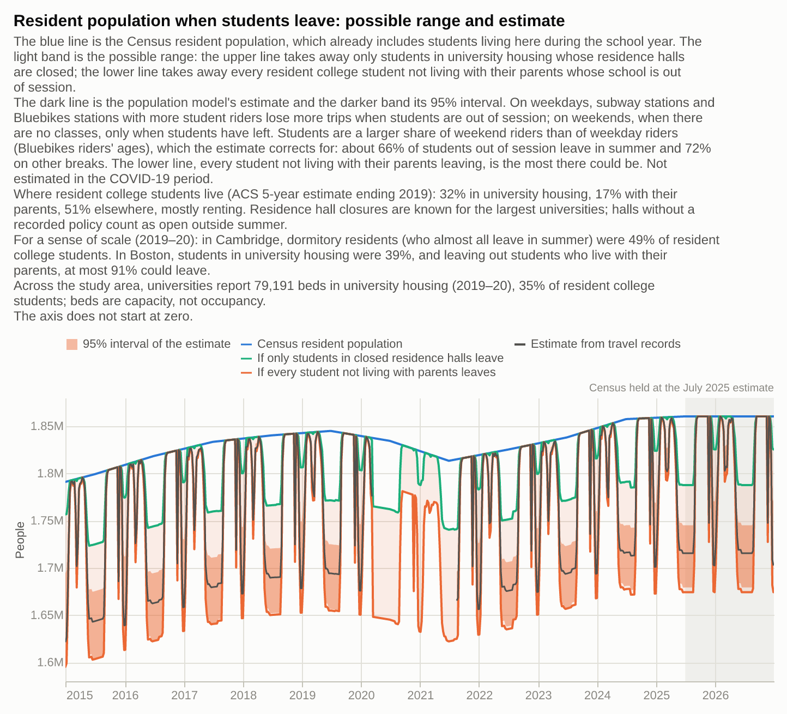

# Boston Breathes: Measuring Greater Boston's Seasonal Population

## Project Description

> **How does Greater Boston's effective population change throughout the year, and how much of that variation can be explained by university students?**

**Study area.** The Inner Core of the Metropolitan Area Planning Council (MAPC): 22 cities and towns (Boston, Cambridge, Somerville, Brookline, Arlington, Belmont, Chelsea, Dedham, Everett, Lynn, Malden, Medford, Melrose, Milton, Needham, Newton, Quincy, Revere, Saugus, Waltham, Watertown, and Winthrop) with about 1.85 million residents, of whom about 220,000–230,000 are college students, followed week by week from 2015 to 2026.

**Approach.** The Census already counts students where they live during the school year, so students leaving can only lower the population:

**P<sub>seasonal</sub>(t) = P<sub>Census</sub>(y) − N<sub>students away</sub>(t)**

where P<sub>seasonal</sub>(t) is the resident population present in week t, P<sub>Census</sub>(y) the Census resident population in that year, and N<sub>students away</sub>(t) the resident college students away that week. Academic calendars, enrollment and where students live give how many students are out of session each week; Bluebikes trips and MBTA subway entries give how many of them actually leave. Commuters, tourists and summer-only arrivals are outside the scope.

## Goals

1. **Estimate the seasonal population** week by week since 2015.
2. **Check it against travel records**, after accounting for weather, season, year, holidays and network size, separating students from other riders by campus areas, riders' ages and each university's own calendar.
3. **Show it interactively**: move through any academic year and watch the population rise and fall (`figures/e_year_explorer.html`).

---

## Modeling Methods and Evaluation

This section gives the [models attempted](#models-attempted), [how their performance was tested](#how-performance-was-tested), the [performance](#performance), [the final model](#the-final-model), and [why these features and models](#why-these-features-and-models) were chosen; the population findings are under [Results](#results).

* **Travel models** (goal 2) predict weekly travel and test whether the **Student Presence Index**, the share of the area's students in session each week, improves the prediction.
* **The population model** (goal 1) estimates the weekly population. Travel is its evidence, not its target: how much travel falls at stations with more student riders says how many students left.

**What is validated.** Nobody counts the population each week, so no estimate of it can be checked against observed counts. What is observed, and scored on data the models were not fitted on, is travel: the population model is chosen by how well its versions predict later years' weekend subway travel, and the population is inferred from the best of them. How accurate that inference is in people is shown only on simulated signals with a known truth.

### Models attempted

| Model | Question | Method | Main result |
|---|---|---|---|
| Travel models (`model_comparison.py`) | Does the index improve predictions of weekly travel? | Linear regression with a smooth seasonal curve or week-of-year levels; gradient-boosted trees; each with and without the index | The best model for every target includes the index |
| Pooled campus model (`campus_panel.py`) | Does each campus follow its own university's calendar? | Fixed-effects regression: a level for every week and for every campus-year | Bluebikes +21%, subway +11% when the own university is in session (verified calendars); other universities' calendars at most +6% |
| Population model (`population_model.py`) | How many students out of session leave? | Weekly slopes of station entries on the station's share of student riders; weekdays fix the scale, weekends measure leaving; six versions of who leaves | Every student not living with parents leaving predicts later years' weekend travel 18–24% better than nobody leaving, 20% on the 2026 test (closed halls only: 8–13%) |
| Model families (`travel_models.py`) | Do flexible models or weather features read the signals better? | Eight families, from linear regression to a neural network; six feature sets | On these signals, linear models do as well as any |
| Joint model (`joint_population.py`) | Do the subway and Bluebikes agree? | Shared shares away fitted on both signals; weather removed by each family | Summer share 0.83 (0.69–0.99), breaks 0.91 (0.52–1.28) |
| Known-truth simulation (`population_accuracy.py`) | How accurate is the method in people? | Signals simulated from known shares with the real noise, then refitted | Unbiased; a summer or break week typically off by 12,000–18,000 students |
| Weekend-rider check (`weekend_riders.py`) | Are students the same share of weekend riders as of weekday riders? | Bluebikes members' ages, 2016–2019 | No: near student-heavy campuses their excess is 1.26 times as large on weekends (1.11–1.48); the estimate corrects for it |

The fitted model is also used for **scenarios** (2025–26 with one input changed) and a **forecast** of 2026–27.

### How performance was tested

* **Travel models: held-out months.** Travel levels change far more between years than within them (the Bluebikes network grew fivefold; subway entries are still about a third below 2019), so a model fitted on earlier years cannot predict the level of later ones. Each calendar month is held out in turn, with the week on either side, and predicted from the other weeks; error is the RMSE of the logarithm of weekly travel.
* **Population model and model families: forward in time.** Travel and inputs enter as deviations from their mean over the same year, so years can be compared despite their levels. Each version is fitted on earlier years and scores the weekend travel of later ones against a model in which nobody leaves: 2023 from 2022, 2024 from 2022–2023, 2025 from 2022–2024, and 2022–2025 from 2016–2019 across the COVID-19 gap (validation). January–September 2026 (38 weeks) is the test, scored once after the measure and version were chosen.
* **Uncertainty:** refits on calendar months drawn with replacement, widened by 1.4 so that, on simulated signals, the intervals contained the known truth 94–95% of the time (79–86% before widening). This shows the method can give 95% intervals; it does not prove that the real population is inside them 95% of the time.
* **Evidence not used in fitting:** the COVID-19 absences of 2020–2021, and Bluebikes fitted on its own ([Checks against other evidence](docs/technical_notes.md#checks-against-other-evidence)).

### Performance

All scores are on travel the models were not fitted on.



| Who leaves when out of session (Semester Pass measure) | 2023 from 2022 | 2024 from 2022–23 | 2025 from 2022–24 | 2022–25 from 2016–19 | Test: 2026 from 2022–25 |
|---|---|---|---|---|---|
| Only students in closed residence halls | −8.0% | −12.9% | −10.4% | −11.3% | −13.3% |
| **Every student not living with parents (chosen)** | **−17.6%** | **−24.3%** | **−18.5%** | **−19.2%** | −19.8% |
| The same fraction leaves on every break, estimated from travel | −16.7% | −22.5% | −17.7% | −18.7% | **−20.0%** |
| One fraction for summer and another for other breaks, estimated | −15.8% | −20.1% | −17.0% | −18.9% | −19.1% |
| A separate fraction for each kind of break (summer, Thanksgiving, winter, spring), estimated | −13.3% | −20.9% | −16.8% | −18.3% | −18.0% |

* Each row is a guess of who leaves when their school is out of session; "fraction" means the fraction of those students who leave the area, estimated from the earlier years' travel. Change in the error of predicted weekend travel against nobody leaving; in bold, the best version of each run. Every version in which most students leave beats closed halls only in every run. The chosen version was best in all four validation runs and within 0.2 points of the best on the test.





* No family is best everywhere, so model complexity helps for some targets, not all. Gradient-boosted trees predict the campus ratios best (Bluebikes: 6.3% typical error, R² 0.91), but the Bluebikes total worst (18.3%), because trees cannot carry the network's growth into a held-out month; the linear models with week-of-year levels predict both totals best. Little explains the near-campus share of subway entries (R² about 0.3), whose stations also serve commuters ([Travel Models in Detail](docs/technical_notes.md#travel-models-in-detail)).

### The final model

The population estimate takes the shares of students out of session who leave, fitted on the subway and Bluebikes together, and divides them by the weekend factor:

1. **Most students out of session leave.** The versions of who leaves in which most do predict later years' travel far better than closed residence halls only (table above).
2. **The subway and Bluebikes together** put the share at 83% in summer and 91% on other breaks, at or above what the chosen version assumes (every student not living with parents, about 83%), with narrower intervals than either signal alone.
3. **Weekend correction.** Near campuses, students are a larger share of weekend riders than of weekday riders (1.26 times, from Bluebikes members' ages), so weekend travel overstates leaving by that factor. Divided by it: **66% in summer (95% interval 52–82%) and 72% on other breaks (41–107%)**. A share above about 83% means every student who could leave does, so the top of the breaks interval is all of them.



**Students who walk, drive, or take a taxi or Uber.** The model does not need to see how each student travels. Subway and Bluebikes riders are a sample: how much travel falls at stations with more student riders measures what fraction of the student riders are missing, not how many students there are. That fraction is then applied to every resident college student out of session, counted from enrollment, where students live and the calendars, however they get around. This assumes students who walk, drive or use ride-hailing leave at the same rate as those who ride the subway or Bluebikes; there are no weekly public data on driving or ride-hailing to check it. Students who live with their parents (17%) are assumed to stay.

### Why these features and models

* **The Student Presence Index** is enrollment times the share of each week the university is in session, from the calendars of 22 universities (93% of in-person students). Universities break at different times and their dates move between years, which is what lets the index be told apart from the seasons.
* **Controls** remove what moves travel apart from students: weather (temperature, rain, snow, heat), holidays and the Christmas–New Year week, network size, year levels and season. Without the Christmas–New Year flag the index took credit for the citywide slowdown (total Bluebikes trips +47% instead of +29%).
* **Comparisons within the same week** (campus areas against the rest, stations against each other) cancel the weather and citywide events that hit every station alike.
* **Weekdays against weekends:** on weekdays every student out of session stops going to class; on weekends only those who left are missing. That difference is what identifies leaving.
* **The Semester Pass share of riders** (sold through universities) was chosen among three survey measures of student riders on the validation years: it gave the largest gain (20% on average, against 14% and 11%).
* **Linear models** were kept because they predicted later years as well as the flexible families with 50 to 150 training weeks, and their coefficients can be read. The trees fit the campus ratios best but the totals worst, because they cannot carry the networks' growth into a held-out month.

---

## Results

The population is estimated from travel, not counted: the numbers below are what the best-validated model infers, with intervals whose 95% coverage was shown on simulated data (see [Limits](#limits)).



1. **When students are here.** The Student Presence Index gives the share of the area's students in session each week (figures B5 and B6).
2. **How many could leave.** Between the students whose residence halls close and every resident college student not living with their parents: 73,000–190,000 in summer 2019 (4.0–10.3% of residents) (figure B7, light band).
3. **Travel follows the students.** The near-campus share of Bluebikes trips moves with the index (median correlation within a year 0.85) and dropped in 76% of 293 university breaks; in September, weekday bicycle counts near campuses are 17.5% above June, against 1% elsewhere, while car counts barely change. The effect is largest at residential campuses (Northeastern +46%, MIT +34%) and absent downtown ([Pooled campus model](docs/technical_notes.md#pooled-campus-model)).
4. **How many actually leave.** About 66% of students out of session leave in summer (95% interval 52–82%) and 72% on other breaks (41% to all). In 2019: about 151,000 students away in mid-July (120,000–188,000), 61,000 in a spring-break week, 117,000 at Thanksgiving and 164,000 in the week after Christmas, the year's low point; 67,000 on average (3.6% of residents) (figure B7, dark band; [Population model](docs/technical_notes.md#population-model)).
5. **Checks the model was not built from.** The absences of COVID-19 show in 2020–2021 travel, and Bluebikes, fitted on its own, also finds most students leaving ([Checks against other evidence](docs/technical_notes.md#checks-against-other-evidence)).
6. **What if.** With 10% fewer students, the term-time population is about 19,000 lower and the summer one about 6,000; if every spring break fell in the same week, about 149,000 students would be away that week, more than in summer; a remote fall term like 2020's would keep about 51,000 away every fall week ([Scenarios](docs/technical_notes.md#scenarios)).
7. **Forecast for 2026–27.** Like 2025–26, except that spring breaks bunch more: about 84,000 students away in the busiest week of March 2027, against 58,000 in 2026 ([Forecast](docs/technical_notes.md#forecast)).

### Limits

* **The weekend correction was measured on Bluebikes only.** Near campuses, students are a larger share of weekend riders than of weekday riders (members aged 18–24, 2016–2019: 1.26 times, 95% interval 1.11–1.48), so the shares read from weekend travel are divided by that factor. The subway could not be tested: if only Bluebikes needed the correction, about 164,000 rather than 151,000 students were away in mid-July 2019; with no correction at all, about 190,000, just above the band. Riders aged 18–24 also include young people who are not students.
* **The 95% intervals are calibrated on simulated data, not checked against the real population**, since nobody counts it each week: on simulated signals they contained the truth 94–95% of the time after widening. That holds only if the model, with its weekend correction, is right.
* **Travel pins down the shares over many weeks, not a single week**: read week by week, it misses the estimate by about ±89,000 students.
* **One test year, one survey measure.** The test is January–September 2026, and the result rests on the Semester Pass measure: with the other two survey measures, 2026 shows little or no gain.
* **Scope.** Only resident college students who leave are counted, not visitors, commuters or summer arrivals. Students who walk, drive or use ride-hailing are assumed to leave at the same rate as subway and Bluebikes riders: no weekly public data exist for driving or ride-hailing, and Boston's 311 requests carry no student signal.
* **Calendars and COVID-19.** Several smaller colleges have only one or two years of collected calendar; the COVID-19 period (spring 2020 to summer 2021) is not estimated. These are associations after accounting for weather, season and network growth, not a controlled experiment.

---

## Figures

`make figures` writes every chart to `figures/` as a PNG and on six self-contained pages that open in any browser, with hover values and each chart's values as a table.

| Page | What it shows |
|---|---|
| `a_data_overview.html` | which datasets cover which years; Bluebikes trips; the academic calendars; enrollment |
| `b_student_presence.html` | the Student Presence Index; the weekly range of the population and the estimate |
| `c_activity_vs_presence.html` | whether Bluebikes, MBTA and street activity near campuses follows the students |
| `d_map.html` | the campus zones and the Bluebikes and MBTA stations |
| `e_year_explorer.html` | one academic year, week by week: choose a year, move the slider or press Play |
| `f_model_performance.html` | how well the models predict data they were not fitted on, and how the final estimate was reached |

* **Student Presence Index (0 to 1):** the share of the area's in-person students whose university is in session that week: 1 when every university is in session, 0 when all are on break.
* **The population range:** the upper line takes away only students whose residence halls are closed, the lower line every resident college student not living with their parents whose school is out of session; the estimate from travel records (dark line, with its 95% interval) lies between them. COVID-19 weeks are flagged, and enrollment after fall 2023 and the Census after July 2025 are held at their latest values.

---

## How to Run

You need Python 3.11 or later, `make`, and internet access for the downloads.

```
make install    # create .venv and install the pinned packages in requirements.txt
make all        # make data, make analysis and make figures, in that order
make test       # run the tests
```

| Command | What it does | Time |
|---|---|---|
| `make data` | Downloads every source (about 2 GB on the first run) and writes the processed tables to `data/processed/` | Long on the first run; later runs reuse the downloads |
| `make analysis` | The travel models, the population model and its exploration, the accuracy test, the weekend factor, then the estimate, scenarios and forecast, in that order | About 30 minutes |
| `make figures` | The PNG images and HTML pages in `figures/` | About a minute |
| `make test` | The tests in `tests/`; GitHub Actions runs them on every push | Under a minute |

The processed tables and figures are committed, so `make analysis`, `make figures` and `make test` work on a fresh clone without `make data`. Every step can also be run on its own (the Makefile lists them in order, with what each needs). Downloads go to `data/raw/` and intermediate files to `data/interim/`; neither is committed.

---

## Data Sources

| Source | Used for |
|---|---|
| U.S. Census Bureau population estimates (2010–2020 intercensal, latest vintage) | the resident population of each town, each year |
| IPEDS (fall enrollment, distance education, housing capacity) | in-person enrollment of each institution |
| American Community Survey and its microdata, 2020 Census, City of Boston and City of Cambridge student housing reports | how many college students live in the study area, and where |
| Academic calendars of 22 universities, collected by hand; residence hall break policies | the Student Presence Index; which halls close |
| Bluebikes trip files (2015 onward; rider birth year until April 2020) | travel near campuses and in total; riders' ages for the weekend correction |
| MBTA gated station entries (2014 onward) and the 2025 System-Wide Passenger Survey | subway travel; the share of student riders at each station |
| NOAA daily weather at Logan Airport | weather controls |
| City of Boston street counts and 311 service requests | checks; tried as signals |
| MassDOT traffic counts and rideshare trips | not used: not published weekly or monthly for the study area |

The full record of how each source was processed, the decisions taken, and each model and check in detail is in [docs/technical_notes.md](docs/technical_notes.md).

---

## Status

* **Done:** every source processed onto the weekly timeline, the Student Presence Index, the population model and estimate with calibrated intervals and the weekend correction, the travel models, the checks, scenarios and the 2026–27 forecast, the figures and year explorer, tests, and GitHub Actions.
* **Still to do for the final submission:** the final report and the presentation.
